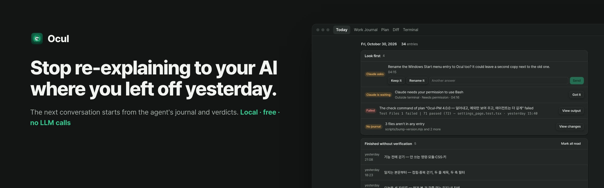
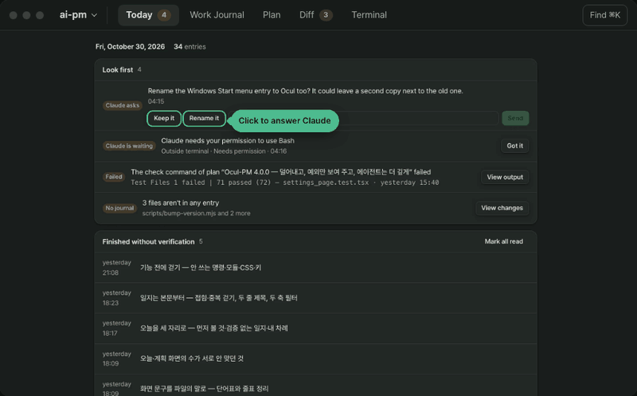
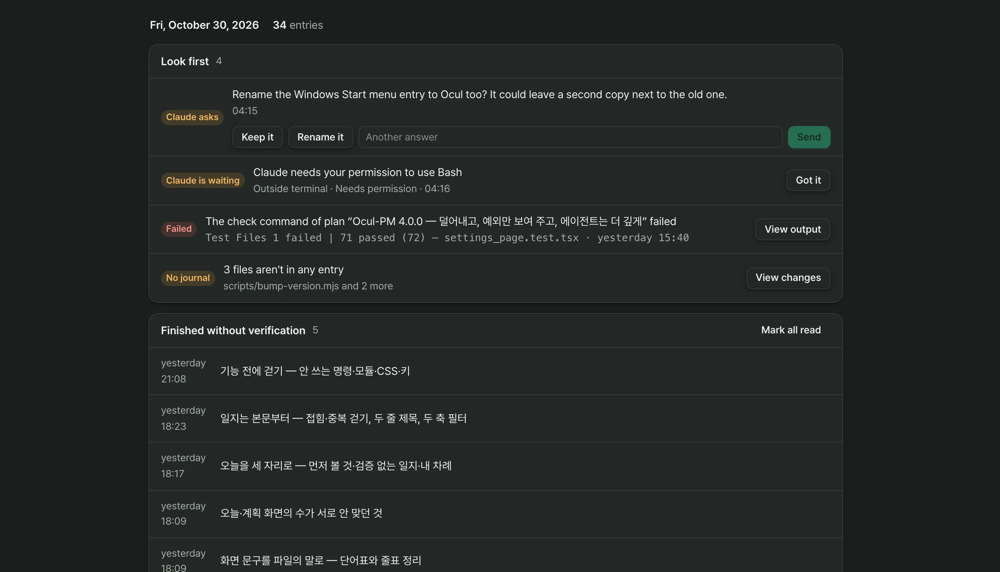
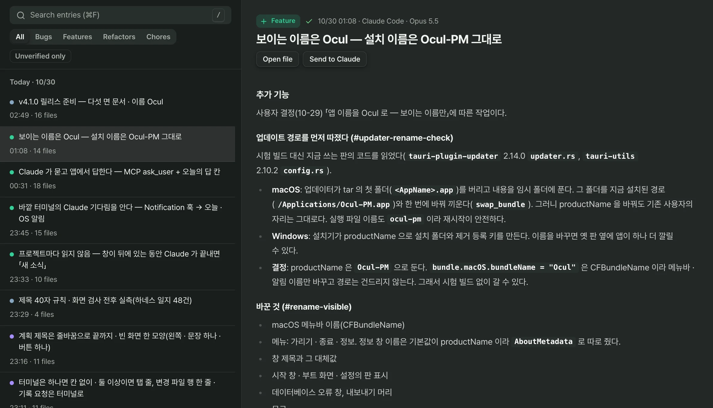
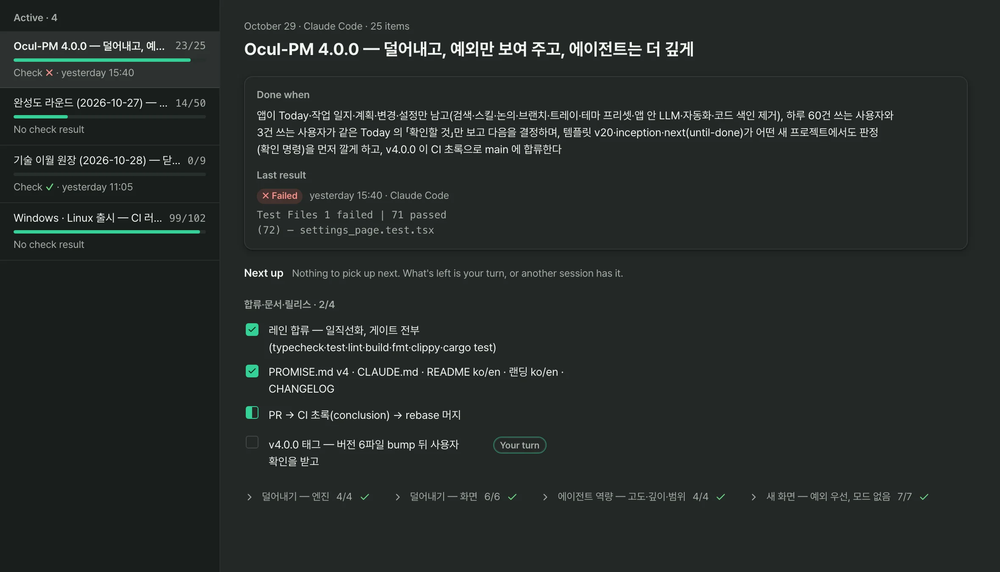
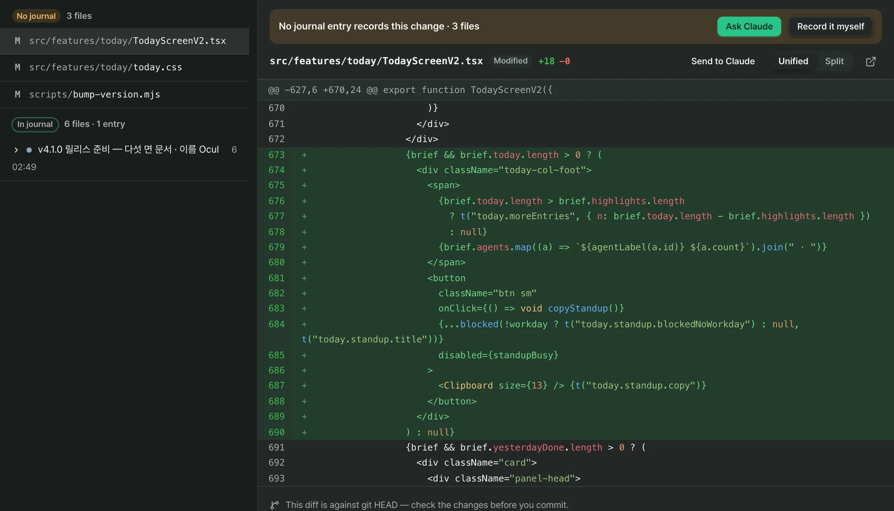

<div align="center">





<sub>Real 4.1 screens, filled with this repository's journal; only Claude's question is demo data. Running the agent in your own terminal leaves the same records.</sub>

<h3>Stop re-explaining to your AI where you left off yesterday.</h3>

<p>It gets a person to <b>trust what the agent did, and decide what's next, in three minutes</b> — and gets the agent to <b>lay down a verdict first</b>, whatever it starts. Journal, diff and plan are the evidence, and the verdict is not the agent's word but the last line of a check command's output.<br/>
A local-first project manager for Claude Code · Codex · Cursor · Gemini CLI — no server, no account, and the app never calls an LLM.</p>

[](https://github.com/bunhine0452/Ocul-PM/actions/workflows/ci.yml)
[](https://github.com/bunhine0452/Ocul-PM/releases/latest)
[](https://github.com/bunhine0452/Ocul-PM/releases)
[](https://github.com/bunhine0452/Ocul-PM/releases/latest)
[](https://github.com/bunhine0452/Ocul-PM/releases/latest)
[](https://github.com/bunhine0452/Ocul-PM/releases/latest)
[](https://tauri.app)
[](LICENSE)
[](https://ko-fi.com/beachcombers)

<a href="https://www.producthunt.com/products/ocul-pm?embed=true&amp;utm_source=badge-featured&amp;utm_medium=badge&amp;utm_campaign=badge-ocul-pm" target="_blank"><picture><source media="(prefers-color-scheme: dark)" srcset="https://api.producthunt.com/widgets/embed-image/v1/featured.svg?post_id=1237239&amp;theme=dark"></picture></a>

[oculpm.com](https://oculpm.com/en) · [Wiki](https://oculpm.com/wiki/en) · [Download](https://github.com/bunhine0452/Ocul-PM/releases/latest) · [Changelog](CHANGELOG.md) · [Issues](https://github.com/bunhine0452/Ocul-PM/issues)

[한국어](README.md) · English

</div>

---

If you build with AI every day, every morning starts the same way: open a new conversation and explain, from scratch, how far you got yesterday, why you touched those files, and what is still left. When the conversation ends, the context ends with it — the code survives, the context doesn't.

Ocul removes that explanation. Plant a single rules file (`AGENTS.md`) in your project folder and the agent writes a markdown journal entry to `.oculpm/journal/` every time it finishes a unit of work; the next conversation receives those entries and the remaining plan — done condition · check command · last verdict — as its starting context and carries on. From that record the app unfolds **only what a person needs to look at**: failed verdicts, entries without command evidence, changes no entry mentions, blocked items, decisions that are yours to make. Work that has its evidence folds to one line. Because the source of truth is plain markdown, it commits alongside your code and stays readable without the app.

There is no server. Your data lives in the project's `.oculpm/` folder and a local SQLite cache, **the app calls no LLM, and its screens (the webview) reach no outside host.** The only things that leave your machine are the ones you start — the update check, and links you click (your OS browser opens them). The full list, countable for yourself, is at [oculpm.com/privacy](https://oculpm.com/privacy), and the build keeps it honest (`src-tauri/tests/egress_inventory.rs`).

> **The promise is ten sentences** — [docs/PROMISE.md](docs/PROMISE.md) (Korean). One rules file makes the agent write a journal entry, the entry shows up in seconds, a diff is attached, Today unfolds only what you need to look at, the next conversation inherits the done condition · check command · last verdict, and the data never leaves your machine. In 4.0 the app is down to five surfaces — **Today · Work Journal · Plan · Diff · Settings** (plus a start window when no project is open). One principle: **show only the exceptions** — the screen grows with what a person must see, not with how much the agent did, so someone with 3 entries a day and someone with 60 use the same screen with no modes. What was removed, and the measurements behind it, are in that document too.

## One round trip — work · entry and verdict · resume

This one round trip matters more than any feature list. Try it in the project you actually work in.

1. **Work** — ask Claude Code in your terminal for something, the way you always do. Pick the folder in the app and turn recording on to plant `AGENTS.md`; [two lines in `/plugin`](#the-claude-code-plugin--start-without-the-app) add the hooks and the recording tools.
2. **Entry and verdict** — when the work is done the agent writes its entry, and with the app open it appears in Journal and Today within seconds. An entry whose verification section has no command and last result line lands in Today's "To check". Running the plan's check command leaves one line, `판정 ✓|✗ <last line of output>` (`verdict ✓|✗` in English), which becomes the "last verdict" right under the plan's title.
3. **Resume** — open a new conversation the next day and the plugin's SessionStart hook loads the recent plans' done condition · check command · last verdict · open items and the last three entries into the starting context. [Run in terminal] on Today and Plan (`r` on Today) has `claude` pick up the next item in a new session of the in-app terminal, and [To the end (/goal)] hands the plan's done condition and check command to Claude Code's `/goal`, so it keeps going until the verdict passes. You don't explain yesterday again.

This round trip is checked by a person on every release, on the **terminal Claude Code + oculpm plugin** path. Other agents (Codex · Cursor · Gemini CLI …) do steps 1–2 from the rules file alone (Codex has hooks too) — the tier table under [Supported agents](#supported-agents) spells out the difference.

## Why results get better — a place for the five principles of using agents

How to use a coding agent well is close to settled. [Anthropic's Claude Code guide](https://code.claude.com/docs/en/best-practices), [Simon Willison's agentic engineering patterns](https://simonwillison.net/2026/Feb/23/agentic-engineering-patterns/), [Sonar's 2026 developer survey](https://www.sonarsource.com/company/press-releases/sonar-data-reveals-critical-verification-gap-in-ai-coding/) and [METR's productivity measurements](https://metr.org/blog/2026-02-24-uplift-update/) say the same five lines. The problem is that all five vanish on `/clear`, and Ocul is where those five questions survive the session boundary ([Rieseberg's altitude, depth and range](https://felixrieseberg.com/how-to-be-more-ambitious-a-tutorial-for-humans-with-models/), as is).

| Principle | Source | Where it lives in Ocul |
|---|---|---|
| ① Write a **done condition** as an outcome before code | Anthropic "write the spec first" | One `**Done when:**` line per plan — not a to-do, but "what must be true to be done, and what should happen next". The session-start hook ships it before the items, and the Plan screen shows it right under the title |
| ② Give the agent **something that passes or fails** | Anthropic "something it can run that comes back pass or fail" · Willison "first run the tests" | The plan's `**Check:**` command. Its result is logged as `verdict ✓|✗ <last line>` and the start hook and the Plan screen read the "last verdict" by the same rule — all items closed is not done until the verdict passes. `/oculpm:inception` makes that command in the first item and shows it red now |
| ③ Take **the command and its output**, not a claim, as evidence | Anthropic "'All tests pass' tells you very little" | The entry's verification section. An entry with no command evidence lands in Today's "To check", and the verification box in Journal calls it "a claim" |
| ④ Green tests are not a running program — **run it** | Willison "passing tests don't mean the server boots" | Rules template v20, "the verdict comes from something that isn't you" — if there's no check command, make one first; even when green, launch it and use it once if you can. Failures get an error entry too |
| ⑤ An **outside judge** decides | Sonar: 96% distrust, 48% always check · METR: feeling ≠ measurement | `/oculpm:redteam` hunts counter-examples before a merge, and the line at the top of Today shows, every day, the share of entries with outside-judge evidence — the target is a number in [PROMISE.md](docs/PROMISE.md) (97%) |

What it doesn't give is written down too. Ambition itself is the human's job — Ocul doesn't write the done condition for you and doesn't hand down the verdict. It asks and points; it never blocks.

## 🚀 v4.2 — Pick from several, comment per line, windows down to a third

- **One task, several worktrees** — the terminal's "Race" gives one prompt to claude in 2–4 lanes, and a strip shows each lane's changed lines · the journal entry its Claude wrote · the last line of its check command. Among lanes checked by a command, the smallest change gets "Pick", and "Use this" brings that change into your folder as uncommitted changes.
- **Line notes → Claude** — comment on changed lines in Diff and send them in one go. A sent note shows "Fixed" once its line changes and "Open" while it stays, and survives reopening the window.
- **Terminal** — two sessions side by side (⌘\), drag files and images in from Finder to type their paths, hover an image path to preview it (back again), and hyperlinks open in the browser.
- **Narrow windows · less empty space** — shrink the window to 480pt (a third of a MacBook Pro 14) and the top bar turns to icons, screen actions fold into "⋯", lists sit above details. Today uses two columns when wide, the start window is a one-line list, and every plan phase is a card.
- **Entry titles are "Area: what was done", within 40 characters** — the recording tool refuses any other shape. Update the plugin with `/plugin update oculpm@oculpm`.
- **Per window** — a window's "Close?" prompt · Getting started · `oculpm://` confirmation no longer pop up in every other window. Removing a project from the list can now also move its record folder to the Trash.

## Earlier releases at a glance

The per-release narrative is in the [web changelog](https://oculpm.com/changelog) and [CHANGELOG](CHANGELOG.md). Below, one line per theme — many of these screens were removed on 2026-10-28 and in 4.0; the reasons are in [PROMISE.md](docs/PROMISE.md).

- **Talking with Claude, and the name is Ocul** (4.1) — the visible name Ocul (the install name stays), one line on Today plus an OS notification when Claude waits, answering Claude in the app through the MCP tool `ask_user`, "Send to Claude" · `/goal`, ⌃Tab · ⌥⌘1–9, a first-run guide.
- **Five surfaces, exceptions only** (4.0) — Today · Work Journal · Plan · Diff · Settings and the in-app terminal remain, and Today unfolds only failed verdicts · entries without evidence · unrecorded changes · blocked items · decisions that are yours. A plan ends at its **last verdict** (the check command's last result line), not its items. The app calls no LLM (summaries · rollups · automation · semantic code search are gone), one window = one project, rules template v20.
- **Records you can trust** (3.2 → 3.17) — a review is bound to the content it saw (3.2), two processes can no longer overwrite the same entry (3.2), an "evidence" grade on every entry and a plugin-version check (3.15.1), done condition → check command at the head of every plan (3.16), a start hook that hands the last entries to the next session (3.4), and finding and linking at 700 entries (3.4).
- **Safe to open someone else's repository** (3.8 → 3.11) — repository settings alone never start background work, secret masking is always on, symlinks can't reach outside the project, a CSP on the screens, and repository-chosen commands run only after you trust the project.
- **Windows · Linux beta** (3.6 → 3.13.7) — only OSes whose build passes install → launch → real-app E2E on CI runners ship. Releases go CI-green tag commit → draft → signature, notarization and updater-signature checks → public (3.2).
- **Shrinking** (3.7 → 3.13.6) — the Sessions (A2A) screen (3.7), Notion (3.13), the mobile beta · debugger · Code Map · remote theme gallery · VS Code extension (3.13.6).
- **v2.5 → v2.48** — the Claude Code plugin (2.5), English UI (2.8), Chrome-style tabs (2.9), in-app editor · LSP · debugger · terminal · in-app agents (2.10 → 2.47), theme files (2.28), a web changelog and privacy ledger (2.31), removing the "made by AI" look (2.33), the repository counting its own outbound connections (2.43), signed and notarised builds (2.45). Most of that era's side screens were removed in later releases.

## Screens

The app is five screens (Today · Journal · Plan · Diff · Terminal) plus Settings. One principle — **show only the exceptions.** On first launch, the four-page "Getting started" guide walks through this briefly; reopen it from the Help menu or ⌘K.

<p>




</p>

- **Today** (⌘1) — **"Look first"** on top: Claude is waiting · Claude asks (answer it right there) · failed verdicts · changes with no journal · blocked items · a new plugin version. When it's empty, one calm paragraph. Below it, "Finished without verification" (Read · Mark all read), the next item with [Run in terminal], one "your turn" line counting human-owned items, who is working now, and "Done today" grouped by plan (a group whose evidence is complete folds to one line). `j`/`k` move · `v` read · `r` run next.
- **Journal** (⌘2) — a list on the left (by date · type · evidence) and the detail on the right, body first — the verification box (the command that ran and its last result line, or "a claim" when there's none), an inline diff per recorded file, related entries. The "Plan … #item" in the header jumps to that plan item. Journal search (`/`) lives here — titles · files · tags · body.
- **Plan** (⌘3) — `.oculpm/planner/*.md` is the source. Right under the title: done condition · check command · **last verdict** ("Not run yet" when there is none), the next item with [Run in terminal] · [To the end (/goal)], and items by phase. Click an item's box to change its status; every item has "Send to Claude". Creating and editing plans is the agent's job (`plan_create` · `plan_update`).
- **Diff** (⌘4) — uncommitted / last-commit diffs, offline, line by line. **"No journal"** (files no entry mentions) comes first, the rest grouped by entry. A file with no journal gets [Ask Claude] (asks the in-app terminal's claude to record it) and [Record it myself]. One line per file (M · A · D), unified / split. Hover a line for "+" to leave a note, send the notes to Claude in one go, and each sent note shows on its own whether its line changed (Fixed · Open).
- **Terminal** (⌘5) — in-app sessions started in the project folder. They end with the window or the app, and closing while something runs asks first. One session is just the terminal; two or more get a tab row on top. Claude Code's status signal tells it working · waiting · done. ⌘\ puts two sessions side by side, "Race" runs one task in 2–4 worktrees for you to pick from, dragging from Finder types the path, and hovering an image path shows the picture.
- **Settings** (⌘,) — one page: agent connection (Claude Code plugin · Codex · agents that use the rules file only) · this project (rules-file version · turn recording on) · display (language · light/dark/system · text size) · data (compact cache · rebuild · updates · log folder).
- **Start window** — a window with no project: recent projects and Open folder — pick a folder and that window becomes the project. Removing a project (×) can also move its record folder (.oculpm) to the Trash.

One window is one project. ⌘1–⌘5 or ⌃Tab · ⌃⇧Tab switch screens, ⌘K finds screens · projects · entries · plans, and ⌘[ / ⌘] or a two-finger swipe go back and forward. ⌘O opens recent projects, ⌥⌘1–9 jumps to an open project window (Alt+1–9 on Windows · Linux), ⇧⌘N opens a new (start) window, ⌘W closes the window. Click the project name (▾) in the top bar to see "Your turn · New · N running" per project. Pick your UI language — **한국어 · English** — in Settings → Display.

## Supported agents

"Supported" hides three different promises, so we split them into tiers. The tiers are read from code, not from marketing copy — the rules-file adapter table (`src-tauri/src/oculpm/agents/`), the MCP registrars (`oculpm/mcp/register.rs` · `mcp/codex.rs`), the hooks (`plugin/*/hooks/`).

| Tier | What it means |
|---|---|
| **1 · Rules-compatible** | Ocul only writes the rules file that agent reads (`AGENTS.md`, a `.claude/CLAUDE.md` block, `.cursor/rules/*.mdc`, `GEMINI.md` …). Journals get written only as far as the model obeys the rules. |
| **2 · Structured journaling** | The agent can call the `oculpm` MCP server's tools (`journal_write` · `plan_update` …). The plugin registers the server (Claude Code) or walks you through it (Codex). |
| **3 · Session observation** | Ocul receives session start/stop through hooks and can tell when a conversation ended without a journal (the Stop delivery gate · `sessions.json` · the verdict). |

| Agent | Tier | What Ocul does | Verified |
|---|---|---|---|
| **Claude Code** | 3 Session observation | the oculpm plugin (hooks · MCP tools · skills) · `AGENTS.md` + `.claude/CLAUDE.md` block | v3.0.0 · 2026-09-11 |
| **Codex** | 3 Session observation | the Codex plugin (hooks · guidance for the `~/.codex/config.toml` MCP registration) · `AGENTS.md` (native, no dedicated file) | v2.37.0 · 2026-09-03 |
| **Gemini CLI** | 1 Rules-compatible | `AGENTS.md` + `GEMINI.md` block | — |
| **Cursor** | 1 Rules-compatible | `.cursor/rules/ocul-pm.mdc` | — |
| **GitHub Copilot** | 1 Rules-compatible | `.github/copilot-instructions.md` block | — (shipped v2.0.0) |
| **Windsurf** | 1 Rules-compatible | `.windsurf/rules/ocul-pm.md` | — (shipped v2.0.0) |
| **Cline** | 1 Rules-compatible | `.clinerules/ocul-pm.md` | — (shipped v2.0.0) |
| **aider** | 1 Rules-compatible | `CONVENTIONS.md` block | — (shipped v2.0.0) |
| **Zed** | 1 Rules-compatible | `.rules` block | — (shipped v2.0.0) |
| **Antigravity** | 1 Rules-compatible | `.agent/rules/ocul-pm.md` | — (shipped v1.11.0) |
| **pi** | 1 Rules-compatible | `AGENTS.md` only (no dedicated file) | — (shipped v1.11.0) |

How to read it:

- **Verified** is the latest evidence in this repository's own `CHANGELOG.md` and `.oculpm/journal/` that the tier **actually ran** (app version · date). `—` means the code exists but there is no on-device record; "shipped" in parentheses is the version the CHANGELOG lists the feature under. No dates or versions were invented.
- `AGENTS.md` is always planted when you turn recording on. If you're on a tier-1 agent, glance at Today's "unrecorded changes" now and then — files edited without a journal show up there.
- One-click MCP registration for Claude Desktop was removed in 4.0 (it never had a single live-connection record).
- **Platform**: official builds are macOS Apple Silicon plus Windows x64 and Linux x64 as a **beta** (see [Install](#install)). The evidence in the table comes from the macOS build — every Windows/Linux release has passed an install smoke test and a real-app E2E run on CI runners, but reports from real users' PCs are still accumulating, so they stay beta. There is no Intel Mac build yet.

Git backfill tells agents apart by commit signatures.

## The Claude Code plugin — start without the app

Two lines in your terminal's Claude Code and recording begins:

```
/plugin marketplace add bunhine0452/Ocul-PM
/plugin install oculpm@oculpm
```

For Codex, two lines in a terminal:

```
codex plugin marketplace add bunhine0452/Ocul-PM
codex plugin add oculpm-codex@oculpm
```

One plugin configures, across all your projects:

- **A hooks bridge** — session start/end and the moment Claude waits for you (Notification) as real-time signals (one local file append, no network). The app turns that signal into "Claude is waiting" on Today. The start hook ships the recent plans' done condition · check command · last verdict · open items and the last three entries.
- **8 MCP tools** — `journal_search` · `journal_read` · `journal_write` · `plan_status` · `plan_update` · `plan_create` · `project_init` (starts tracking a new project once the user confirms) · `ask_user` (asks for your decision on the app's Today screen and waits for the answer, up to 25 minutes). Agents record through structured tools instead of imitating markdown, eliminating frontmatter errors, and search the hundreds of accumulated entries *before* starting work — one query tells you why that file was touched before.
- **4 commands + 1 skill** — `/oculpm:inception` (what happens next → four depth questions → the field's methods → a hard numeric goal → a plan whose first item is a red verdict) · `/oculpm:next` (claim the item as `[~]` → implement → check command → entry → plan; with `until-done`, until the verdict passes) · `/oculpm:redteam` (runs the claims, reports only counter-examples) · `/oculpm:help`, plus the recording-spec skill for when the tools are absent. The seven that overlapped (self-audit · run-evals · tdd-workflow · standup · board · project_init · project-inception) were removed on 2026-10-28.
- It only acts in `.oculpm`-tracked projects and never touches untracked repos — see the [full read/write contract](docs/claude-integration/06-plugin-contract.md).
- The 4.0 app has no per-project hook/MCP registration settings — the plugin is the way, and Settings → "Agent connections" shows whether it's installed along with the install/update command.


## Install

Grab the file for your OS from the [latest release](https://github.com/bunhine0452/Ocul-PM/releases/latest). The name you see inside the app is Ocul; the install files and the installed app keep the name `Ocul-PM`.

| OS | File | Requirements | Updates |
| --- | --- | --- | --- |
| **macOS** (Apple Silicon) | `Ocul-PM_x.y.z_aarch64.dmg` | — | in-app, automatic |
| **Windows** x64 — beta | `Ocul-PM_x.y.z_x64-setup.exe` | Windows 10 2004 (build 19041) or later · 11 | in-app, automatic |
| **Linux** x64 — beta | `Ocul-PM_x.y.z_amd64.AppImage` | glibc 2.35+ (Ubuntu 22.04 · Debian 12 or later) · libEGL · libGLESv2 · FUSE 2 | in-app, automatic |
| **Linux** x64 — beta (Debian · Ubuntu) | `Ocul-PM_x.y.z_amd64.deb` | same as above (no FUSE needed) | your package manager |

**macOS** — open the `.dmg` and drag the app into `Applications`. It's signed with an Apple Developer ID and notarized, so it opens straight from the download — no `xattr` quarantine workaround needed.

**Windows (beta)** — the installer puts the app in your user folder without admin rights. The beta isn't code-signed, so on first launch SmartScreen shows "Windows protected your PC" — click **More info → Run anyway**. If the Visual C++ runtime is missing, the installer installs it first (that's the only time a confirmation prompt appears). On Windows older than 10 2004 the installer explains why and stops.

- The Claude Code plugin's hooks run on Windows, but **its MCP server does not start** — the agent then writes into `.oculpm/` directly, following the recording-spec skill.

**Linux (beta)** — for the AppImage, `chmod +x Ocul-PM_*_amd64.AppImage` and run it; it auto-updates in-app. It needs FUSE 2 (`sudo apt install libfuse2` on Ubuntu 22.04, `libfuse2t64` on 24.04). Install the deb with `sudo apt install ./Ocul-PM_*_amd64.deb` and update it the same way with the next `.deb` — it isn't updated in-app.

Only Windows/Linux builds that pass install → launch → real-app E2E on CI runners are published for each release. A version that didn't pass has no file for that OS, and its release notes say so. Please report what you hit on a real PC as an [issue](https://github.com/bunhine0452/Ocul-PM/issues) — the app's logs are in Settings → Data → "Log folder". That's what graduates the beta.

macOS may still ask for **access to files or to other apps' data**. That's a separate gate from notarization and doesn't go away because an app is notarized — [Troubleshooting](https://oculpm.com/wiki/en/troubleshooting) explains why and how to revoke it.

To start recording before installing the app, the **Claude Code plugin** above is enough — entries and plans pile up as `.oculpm/` markdown, and the app reads them as-is whenever you install it.

Stuck on something? The [wiki](https://oculpm.com/wiki/en) collects common problems and fixes.

## Where your data lives

```text
your-project/
├── AGENTS.md          # journaling rules agents read (planted & versioned by the app)
└── .oculpm/
    ├── journal/       # work journals — the source of truth
    ├── planner/       # plan documents
    ├── agents/        # the rules master and the entry spec (journal-spec.md)
    └── index/         # app-managed cache · diff archive
```

SQLite is only a derived cache for fast rendering — it can always be rebuilt from the files (Settings → Data → "Rebuild from scratch"). The `discussion/` · `rollups/` · `automation/` folders 3.x created are no longer read by the app, and never deleted. API keys, tokens, private keys and connection strings that accidentally land in journals or diffs are masked before saving (`[REDACTED]`). Only known shapes are caught, so this is not a guarantee for every secret — add patterns with `auto_redact_patterns` in `.oculpm/config.toml`.

## Tech

A Tauri 2 native app — not Electron — so the dmg stays under 60MB and cold start under 1.5s. The backend is Rust (tokio · rusqlite), the frontend React 19 + TypeScript. There is no LLM client, no embedding model and no API-key store in the app — the screens are drawn deterministically from the files.

## Build from source

```bash
git clone https://github.com/bunhine0452/Ocul-PM
cd Ocul-PM
pnpm install
pnpm tauri dev      # run in dev
pnpm tauri build    # your OS's bundle (.dmg · NSIS .exe · AppImage/.deb)
```

Requires Node 18+, pnpm, Rust stable, plus Xcode Command Line Tools on macOS, the MSVC build tools and WebView2 on Windows, and [Tauri's system dependencies](https://v2.tauri.app/start/prerequisites/#linux) (`libwebkit2gtk-4.1-dev` etc.) and `libdbus-1-dev` on Linux.

## Roadmap

- [x] Windows · Linux x64 builds — beta
- [ ] Graduate the Windows · Linux beta (E2E green for three releases in a row + zero P0 user reports)
- [ ] macOS (Intel) — the embedding runtime (ONNX) that blocked it left in 4.0; adding the build and signing pipeline remains
- [ ] Team sync (opt-in)

## One more thing

This repository is itself tracked by Ocul. Open `.oculpm/journal/` and you'll find the actual journals agents wrote while building this app. Bugs and ideas go to [issues](https://github.com/bunhine0452/Ocul-PM/issues) — and if you like it, a star helps more than you'd think.

## Support

Ocul is built and maintained by one person. The app stays free, but building it costs time and money. If it has been useful, you can [buy me a coffee on Ko-fi](https://ko-fi.com/beachcombers) — one-off or monthly.

Supporting changes nothing about what you get. The promise below holds either way.

## License & promise

[MIT](LICENSE) © 2026 Kim Hyunbin

**Everything in this repository today stays free and MIT, forever.** Individual use is free forever — at work or at home. Paid plans will only ever apply to upcoming team features (sync server · team view — a separate module). Core features will never move behind a paywall.

Contributions are accepted under the [DCO (sign-off)](CONTRIBUTING.md), no CLA — the core stays MIT forever, so there is no reason to pool copyright.
