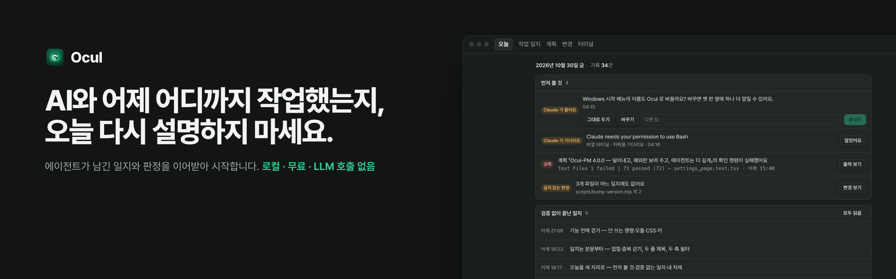
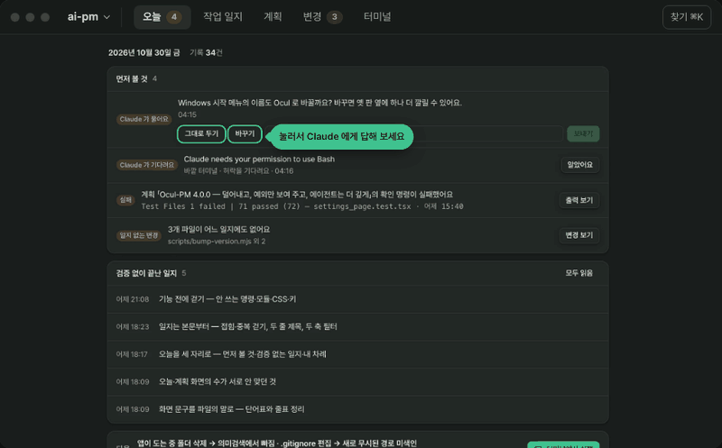
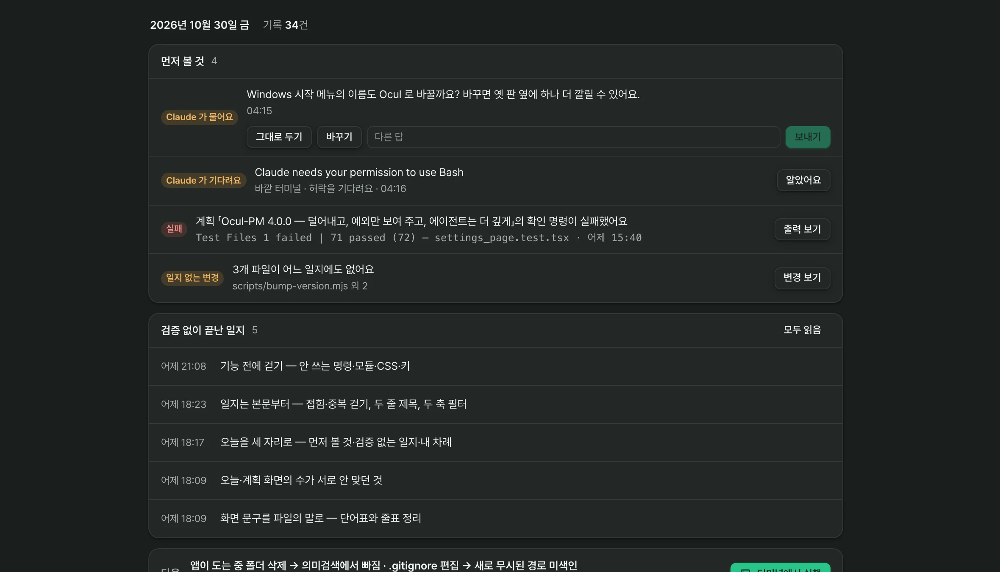
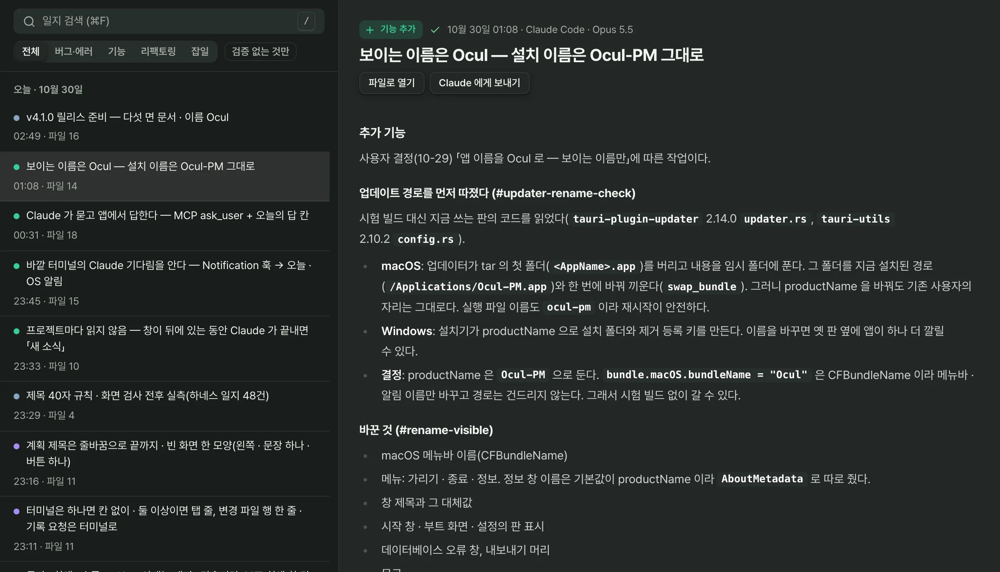
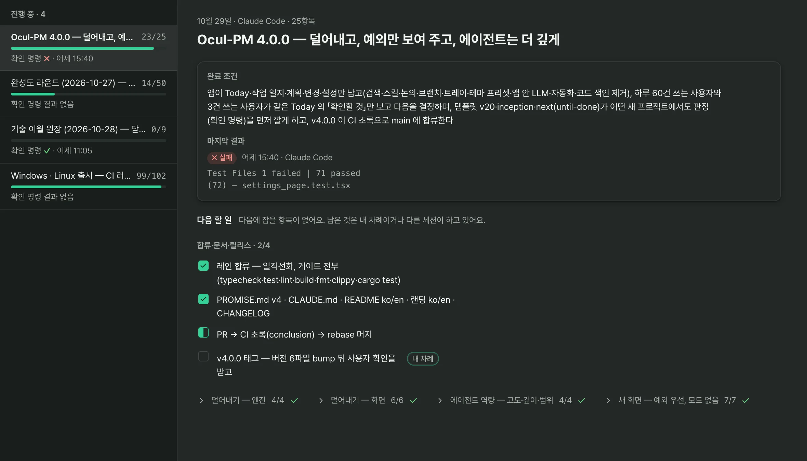
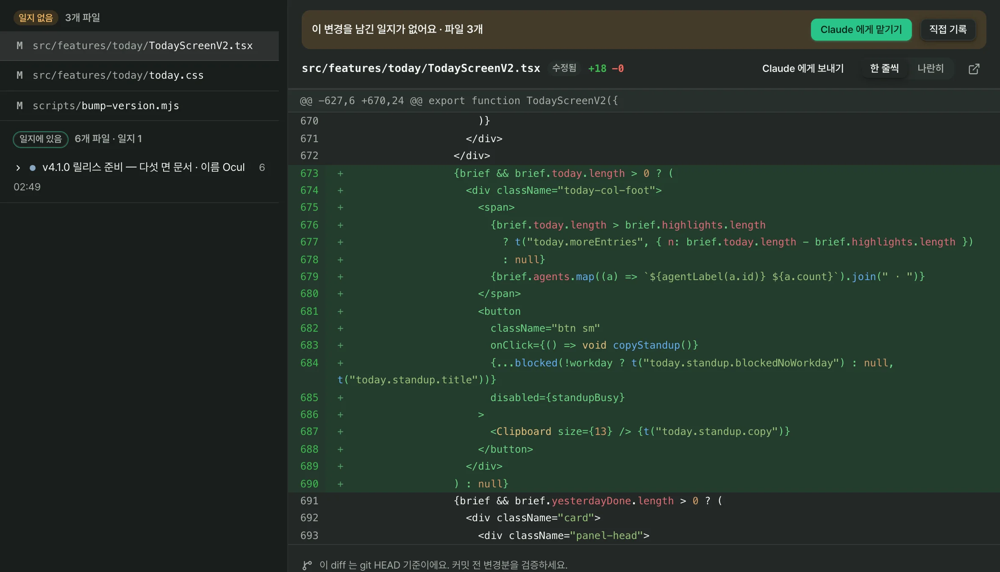

<div align="center">





<sub>실제 4.1 화면입니다. 이 저장소의 일지로 채웠고, Claude 의 질문 한 줄만 데모입니다. 여러분의 터미널에서 돌려도 같은 기록이 남습니다.</sub>

<h3>AI와 어제 어디까지 작업했는지, 오늘 다시 설명하지 마세요.</h3>

<p>에이전트가 한 일을 사람이 <b>3분 안에 믿고, 다음을 결정</b>하게 하고, 에이전트는 어떤 일이든 <b>판정부터 깔고</b> 시작하게 합니다. 일지·diff·계획이 그 증거이고, 판정은 에이전트의 말이 아니라 확인 명령의 결과 끝 줄입니다.<br/>
Claude Code · Codex · Cursor · Gemini CLI 와 함께 쓰는 로컬-우선 프로젝트 매니저 — 서버도 계정도 없고, 앱은 LLM 을 부르지 않습니다.</p>

[](https://github.com/bunhine0452/Ocul-PM/actions/workflows/ci.yml)
[](https://github.com/bunhine0452/Ocul-PM/releases/latest)
[](https://github.com/bunhine0452/Ocul-PM/releases)
[](https://github.com/bunhine0452/Ocul-PM/releases/latest)
[](https://github.com/bunhine0452/Ocul-PM/releases/latest)
[](https://github.com/bunhine0452/Ocul-PM/releases/latest)
[](https://tauri.app)
[](LICENSE)
[](https://ko-fi.com/beachcombers)

<a href="https://www.producthunt.com/products/ocul-pm?embed=true&amp;utm_source=badge-featured&amp;utm_medium=badge&amp;utm_campaign=badge-ocul-pm" target="_blank"><picture><source media="(prefers-color-scheme: dark)" srcset="https://api.producthunt.com/widgets/embed-image/v1/featured.svg?post_id=1237239&amp;theme=dark"></picture></a>

[oculpm.com](https://oculpm.com) · [위키](https://oculpm.com/wiki) · [다운로드](https://github.com/bunhine0452/Ocul-PM/releases/latest) · [변경 이력](CHANGELOG.md) · [이슈](https://github.com/bunhine0452/Ocul-PM/issues)

한국어 · [English](README.en.md)

</div>

---

매일 AI 로 개발하면 아침마다 같은 일을 합니다. 새 대화를 열고, 어제 어디까지 했는지, 왜 그 파일을 건드렸는지, 무엇이 남았는지를 처음부터 다시 설명하는 일입니다. 대화가 끝나면 맥락도 같이 끝나기 때문입니다 — 코드는 남는데 맥락은 남지 않습니다.

Ocul 은 그 설명을 없앱니다. 프로젝트 폴더에 규칙 파일(`AGENTS.md`) 하나를 심으면 에이전트는 작업 하나를 끝낼 때마다 `.oculpm/journal/` 에 마크다운 일지를 남기고, 다음 대화는 그 일지와 남은 계획 — 완료 조건 · 확인 명령 · 마지막 판정 — 을 시작 컨텍스트로 받아 이어서 합니다. 앱은 그 기록에서 **사람이 볼 것만** 펼칩니다: 판정 실패, 명령 증거 없는 일지, 어느 일지에도 없는 변경, 막힌 항목, 사람 몫 결정. 증거가 선 일은 한 줄로 접힙니다. 원본이 전부 마크다운 파일이라 코드와 함께 커밋할 수 있고, 앱이 없어도 그냥 읽힙니다.

서버는 없습니다. 데이터는 프로젝트의 `.oculpm/` 폴더와 로컬 SQLite 캐시에만 있고, **앱은 LLM 을 부르지 않으며 화면(웹뷰)은 바깥 호스트에 닿지 않습니다.** 기기를 떠나는 것은 여러분이 시작한 것뿐입니다 — 새 버전 확인과, 여러분이 누른 링크(OS 브라우저가 엽니다). 세어 볼 수 있는 전체 목록은 [oculpm.com/privacy](https://oculpm.com/privacy) 에 있고, 그 목록은 빌드가 지킵니다(`src-tauri/tests/egress_inventory.rs`).

> **약속은 열 문장입니다** — [docs/PROMISE.md](docs/PROMISE.md). 규칙 파일 하나로 일지가 남고, 몇 초 안에 화면에 서고, diff 가 붙고, 오늘 화면은 사람이 볼 것만 펼치고, 다음 대화가 완료 조건 · 확인 명령 · 마지막 판정을 이어받고, 데이터는 기기를 떠나지 않습니다. 4.0 에서 앱은 다섯 면만 남았습니다 — **오늘 · 작업 일지 · 계획 · 변경 · 설정**(과 프로젝트가 없을 때의 시작 창). 원칙은 하나, **예외만 보여 준다**: 화면의 크기는 에이전트가 한 양이 아니라 사람이 볼 것에 비례하고, 하루 3건 쓰는 사람과 60건 쓰는 사람이 모드 없이 같은 화면을 씁니다. 무엇을 걷었고 왜인지(실측)도 그 문서에 있습니다.

## 한 왕복 — 작업 · 일지와 판정 · 이어하기

기능 목록보다 이 왕복 하나가 이 앱의 전부입니다. 평소 쓰는 프로젝트에서 그대로 해 보세요.

1. **작업** — 터미널의 Claude Code 에 평소처럼 시킵니다. 앱에서 폴더를 고르고 기록을 켜면 `AGENTS.md` 가 심어지고, [플러그인 두 줄](#claude-code-플러그인--앱-없이도-시작)이면 훅과 기록 도구까지 붙습니다.
2. **일지와 판정** — 작업이 끝나면 에이전트가 일지를 남기고, 앱을 켜 두었다면 몇 초 안에 작업 일지와 오늘 화면에 뜹니다. 검증 칸에 돌린 명령과 결과 끝 줄이 없으면 그 일지는 오늘 화면 「확인할 것」에 섭니다. 계획의 확인 명령을 돌린 결과는 `판정 ✓|✗ <결과 끝 줄>` 한 줄로 남아, 계획 화면 제목 바로 아래의 「마지막 판정」이 됩니다.
3. **이어하기** — 다음 날 새 대화를 열면 플러그인의 SessionStart 훅이 최근 계획의 완료 조건 · 확인 명령 · 마지막 판정 · 미완 항목과 마지막 일지 3건을 시작 컨텍스트에 싣습니다. 오늘 · 계획 화면의 [터미널에서 실행](오늘 화면에서는 `r`)이 앱 안 터미널의 새 세션에서 `claude` 가 다음 항목부터 잇게 하고, [끝까지 (/goal)]는 계획의 완료 조건 · 확인 명령을 Claude Code 의 `/goal` 로 넘겨 판정이 통과할 때까지 이어 가게 합니다. 어제를 다시 설명하지 않습니다.

이 왕복은 **터미널의 Claude Code + oculpm 플러그인** 경로에서 릴리스마다 사람이 확인합니다. 다른 에이전트(Codex · Cursor · Gemini CLI …)는 1·2 단계가 규칙 파일만으로 동작하고(Codex 는 훅도 있습니다), 등급별 차이는 아래 [지원 에이전트](#지원-에이전트) 표에 있습니다.

## 왜 결과가 좋아지나 — 에이전트 운용 다섯 원칙의 자리

코딩 에이전트를 잘 쓰는 법은 이미 합의에 가깝습니다. [Anthropic 의 Claude Code 안내서](https://code.claude.com/docs/en/best-practices), [Simon Willison 의 에이전트 공학 패턴](https://simonwillison.net/2026/Feb/23/agentic-engineering-patterns/), [Sonar 2026 개발자 조사](https://www.sonarsource.com/company/press-releases/sonar-data-reveals-critical-verification-gap-in-ai-coding/), [METR 의 생산성 실측](https://metr.org/blog/2026-02-24-uplift-update/)이 같은 다섯 줄을 말합니다. 문제는 그 다섯이 `/clear` 한 번에 사라진다는 것이고, Ocul 은 그 다섯 질문이 세션 경계를 넘어 남는 자리입니다 ([Rieseberg 의 고도 · 깊이 · 범위](https://felixrieseberg.com/how-to-be-more-ambitious-a-tutorial-for-humans-with-models/) 그대로).

| 원칙 | 출처 | Ocul 의 자리 |
|---|---|---|
| ① 코드 전에 **완료 조건**을 결과로 적는다 | Anthropic "write the spec first" | 플랜마다 `**완료 조건:**` 한 줄 — 할 일이 아니라 「무엇이 참이 되면 끝인가, 그다음 무엇이 일어나야 하나」. 시작 훅이 매 세션 항목보다 먼저 싣고, 계획 화면이 제목 바로 아래 둡니다 |
| ② 에이전트에게 **통과/실패를 내는 것**을 준다 | Anthropic "something it can run that comes back pass or fail" · Willison "first run the tests" | 플랜의 `**확인 명령:**`. 결과는 `판정 ✓|✗ <결과 끝 줄>` 로 남고 시작 훅과 계획 화면이 같은 규칙으로 「마지막 판정」을 읽습니다 — 항목이 다 닫혀도 판정이 통과해야 끝. `/oculpm:inception` 은 첫 항목에서 그 명령을 만들고 지금 빨강임을 보입니다 |
| ③ **주장이 아니라 명령과 출력**을 증거로 받는다 | Anthropic "'All tests pass' tells you very little" | 일지의 검증 칸. 명령 증거가 없는 일지는 오늘 화면 「확인할 것」에 서고, 작업 일지 상세의 검증 상자가 「주장이에요」 라고 짚습니다 |
| ④ 테스트가 초록이어도 **실제로 돌려 본다** | Willison "passing tests don't mean the server boots" | 규칙 템플릿 v20 「판정은 네가 아닌 것이」 — 확인 명령이 없으면 그것부터 만들고, 초록이어도 가능하면 실제로 띄워 한 번 써 본다. 실패도 error 일지로 남는다 |
| ⑤ **바깥 심판**이 판정한다 | Sonar: 96% 가 불신, 48% 만 늘 확인 · METR: 느낌 ≠ 실측 | `/oculpm:redteam` 이 합류 전 반례를 찾고, 오늘 화면 맨 위 한 줄이 바깥 심판 증거가 있는 일지 비율을 매일 보여 줍니다 — 목표는 [PROMISE.md](docs/PROMISE.md) 에 숫자로(97%) |

주지 않는 것도 적어 둡니다. 야망 자체는 사람의 몫입니다 — Ocul 은 완료 조건을 대신 만들지 않고 판정을 대신 내리지 않습니다. 묻고 짚되 막지 않습니다.

## 🚀 v4.2 — 여럿에서 고르고, 줄마다 말하고, 창은 3분의 1까지

- **같은 일을 worktree 여럿에서** — 터미널의 「여럿에서」 가 프롬프트 하나를 레인 2~4개의 claude 에 주고, 띠가 레인마다 바뀐 줄 · 그 안의 Claude 가 쓴 일지 · 검증 명령의 끝 줄을 보여 줍니다. 명령으로 검증한 레인 가운데 가장 작은 변경에 「추천」, 「이것으로」 가 그 변경을 원래 폴더에 커밋 전 변경으로 가져옵니다.
- **줄마다 메모 → Claude** — 변경 화면에서 줄에 메모를 달아 한 묶음으로 보냅니다. 보낸 메모는 그 줄이 바뀌면 「고쳐짐」, 그대로면 「아직」 으로 저절로 표시되고, 창을 다시 열어도 남습니다.
- **터미널** — 세션 둘을 나란히(⌘\), Finder 에서 파일 · 그림을 끌어다 놓으면 경로 입력, 이미지 경로에 마우스를 올리면 미리보기(다시), 하이퍼링크는 브라우저로.
- **좁은 창 · 빈 곳** — 창을 480pt(맥북 프로 14 의 3분의 1)까지 줄이면 윗줄은 아이콘, 화면 동작은 「⋯」, 목록은 위 · 본문은 아래. 오늘은 넓으면 두 칸, 시작 창은 한 줄 목록, 계획은 단계마다 카드.
- **일지 제목은 「영역: 무엇을 했다」 40자 안** — 기록 도구가 이 형식이 아닌 제목을 받지 않습니다. 플러그인은 `/plugin update oculpm@oculpm`.
- **창마다 따로** — 한 창의 「닫을까요」 · 처음 쓰는 법 · `oculpm://` 확인이 다른 창에도 뜨던 것을 고쳤습니다. 목록에서 빼기에는 「기록 폴더도 휴지통으로」 가 생겼습니다.

## 지난 릴리스 한눈에

릴리스마다의 서술은 [웹 변경 이력](https://oculpm.com/changelog) 과 [CHANGELOG](CHANGELOG.md) 에 있습니다. 아래는 주제별로 한 줄씩 묶은 것이고, 그중 많은 화면이 2026-10-28 과 4.0 에서 걷혔습니다 — 걷은 근거는 [PROMISE.md](docs/PROMISE.md).

- **Claude 와 주고받기, 이름은 Ocul** (4.1) — 보이는 이름 Ocul(설치 이름은 그대로), Claude 가 기다리면 오늘 화면 한 줄 · OS 알림, MCP 도구 `ask_user` 로 앱에서 답하기, 「Claude 에게 보내기」 · `/goal`, ⌃Tab · ⌥⌘1~9, 첫 실행 안내.
- **다섯 면, 예외만** (4.0) — 오늘 · 작업 일지 · 계획 · 변경 · 설정과 앱 안 터미널만 남기고, 오늘 화면은 판정 실패 · 증거 없는 일지 · 기록 없는 변경 · 막힘 · 사람 몫 결정만 펼칩니다. 계획의 끝은 항목이 아니라 **마지막 판정**(확인 명령의 결과 끝 줄). 앱은 LLM 을 부르지 않고(요약 · 롤업 · 자동화 · 코드 의미 검색을 걷었습니다), 창 하나 = 프로젝트 하나, 규칙 템플릿 v20.
- **기록을 믿을 수 있게** (3.2 → 3.17) — 확인 표시는 확인한 본문의 지문에 묶이고(3.2), 두 프로세스가 같은 일지를 덮지 못하게(3.2), 일지마다 「증거 있음」 등급과 플러그인 판 확인(3.15.1), 계획 머리의 완료 조건 → 확인 명령(3.16), 다음 세션이 지난 일지를 이어받는 시작 훅(3.4), 일지 700건 규모의 찾기·잇기(3.4).
- **남의 저장소를 열어도 안전하게** (3.8 → 3.11) — 저장소 설정만으로는 배경 작업이 돌지 않고, 비밀 마스킹이 늘 켜지고, 심볼릭 링크가 프로젝트 밖에 닿지 못하고, 화면에 CSP, 저장소가 고른 명령은 신뢰한 뒤에만.
- **Windows · Linux 베타** (3.6 → 3.13.7) — CI 러너가 설치 → 실행 → 실제 앱 E2E 를 통과한 OS 만 싣습니다. 배포는 태그 커밋의 CI 통과 → draft → 서명·공증·업데이터 서명 검사 → 공개(3.2).
- **덜어내기** (3.7 → 3.13.6) — 세션(A2A) 화면(3.7), Notion(3.13), 모바일 · 디버거 · 코드 맵 · 원격 테마 갤러리 · VS Code 확장(3.13.6).
- **v2.5 → v2.48** — Claude Code 플러그인(2.5), 영어 화면(2.8), 크롬식 탭(2.9), 인앱 편집기·LSP·디버거·터미널·앱 안 에이전트(2.10 → 2.47), 테마 파일(2.28), 웹의 변경 이력과 개인정보 원장(2.31), 「AI 가 만든 티」 걷기(2.33), 기기 밖으로 나가는 연결을 저장소가 직접 세기(2.43), 서명·공증 빌드(2.45). 이 시기의 주변 화면은 대부분 이후 판에서 걷었습니다.

## 화면 구성

앱은 다섯 화면(오늘 · 작업 일지 · 계획 · 변경 · 터미널)과 설정입니다. 원칙은 하나 — **예외만 보여 준다.** 처음 켜면 「처음 쓰는 법」 네 쪽이 이 내용을 짧게 보여 주고, 도움말 메뉴와 ⌘K 에서 다시 열 수 있습니다.

<p>




</p>

- **오늘** (⌘1) — 맨 위 **「먼저 볼 것」**: Claude 가 기다려요 · Claude 가 물어요(그 자리에서 답합니다) · 판정 실패 · 일지 없는 변경 · 막힘 · 플러그인 새 판. 비었으면 차분한 한 문단입니다. 그 아래 「검증 없이 끝난 일지」(읽음 · 모두 읽음), 다음 할 일 한 줄과 [터미널에서 실행], 사람 몫을 세는 「내 차례」 한 줄, 지금 일하는 중, 계획별로 묶은 「오늘 한 일」(증거가 다 선 묶음은 한 줄로 접힘). `j`/`k` 이동 · `v` 읽음 · `r` 다음 실행.
- **작업 일지** (⌘2) — 왼쪽 목록(날짜별 · 종류 · 증거)과 오른쪽 상세. 상세는 본문부터 — 검증 상자(돌린 명령과 결과 끝 줄, 없으면 「주장이에요」), 기록된 파일별 인라인 diff, 관련 일지. 머리의 「계획 … #항목」 은 그 계획 항목으로 갑니다. 일지 검색(`/`)이 여기 삽니다 — 제목 · 파일 · 태그 · 본문.
- **계획** (⌘3) — `.oculpm/planner/*.md` 가 원본입니다. 제목 바로 아래 완료 조건 · 확인 명령 · **마지막 판정**(없으면 「아직 안 돌렸어요」), 다음 할 일과 [터미널에서 실행] · [끝까지 (/goal)], 단계별 항목. 항목 상태는 상자를 눌러 바꾸고, 항목마다 「Claude 에게 보내기」 가 있습니다. 계획을 만들고 고치는 것은 에이전트(`plan_create` · `plan_update`)의 몫입니다.
- **변경** (⌘4) — 커밋 전 / 최근 커밋의 diff 를 네트워크 없이 줄 단위로. **「일지 없음」**(어느 일지에도 없는 파일)이 먼저 서고 나머지는 일지별로 묶입니다. 일지 없는 파일에는 [Claude 에게 맡기기](앱 안 터미널의 claude 에 기록을 부탁)와 [직접 기록]이 붙습니다. 파일 행은 한 줄(M · A · D), 한 줄씩 / 나란히. 줄에 올리면 뜨는 「+」 로 메모를 달아 한 묶음으로 Claude 에게 보내고, 보낸 메모에는 그 줄이 바뀌었는지(고쳐짐 · 아직)가 저절로 붙습니다.
- **터미널** (⌘5) — 프로젝트 폴더에서 뜨는 앱 안 세션입니다. 창을 닫거나 앱을 끄면 함께 끝나고, 무언가 도는 중이면 먼저 묻습니다. 세션이 하나면 칸 없이 터미널만, 둘 이상이면 위에 탭 줄. Claude Code 가 보내는 상태 신호로 일하는 중 · 기다림 · 끝남을 압니다. ⌘\ 로 두 세션을 나란히, 「여럿에서」 로 같은 일을 worktree 2~4개에서 돌려 고르고, Finder 에서 끌어다 놓으면 경로가 들어가고, 이미지 경로에 올리면 그림이 보입니다.
- **설정** (⌘,) — 한 쪽짜리: 에이전트 연결(Claude Code 플러그인 · Codex · 규칙 파일만 쓰는 에이전트) · 이 프로젝트(규칙 파일 판 · 기록 켜기) · 표시(언어 · 밝게/어둡게/시스템 · 글자 크기) · 데이터(캐시 정리 · 다시 만들기 · 업데이트 · 로그 폴더).
- **시작 창** — 프로젝트가 없는 창입니다. 최근 프로젝트와 폴더 열기 — 폴더를 고르면 그 창이 그 프로젝트가 됩니다. 목록에서 빼기(×)는 기록 폴더(.oculpm)도 휴지통으로 보낼 수 있습니다.

창 하나가 프로젝트 하나입니다. ⌘1~⌘5 또는 ⌃Tab · ⌃⇧Tab 으로 화면을, ⌘K 로 화면 · 프로젝트 · 일지 · 계획을 찾고, ⌘[ / ⌘] 또는 두 손가락 쓸기로 화면 앞뒤를 오갑니다. ⌘O 는 최근 프로젝트, ⌥⌘1~9 는 열린 프로젝트 창(Windows · Linux 는 Alt+1~9), ⇧⌘N 은 새 창(시작 창), ⌘W 는 창 닫기입니다. 윗줄의 프로젝트 이름(▾)을 누르면 프로젝트마다 「내 차례 · 새 소식 · 실행 중 N」 이 보입니다. 화면 언어는 설정 → 표시에서 **한국어 · English** 중에 고릅니다.

## 지원 에이전트

「지원한다」 한 마디에 서로 다른 약속 셋이 섞여 있어 등급으로 나눕니다. 등급은 마케팅 문구가 아니라 코드에서 읽었습니다 — 규칙 파일 어댑터 표(`src-tauri/src/oculpm/agents/`), MCP 등록기(`oculpm/mcp/register.rs` · `mcp/codex.rs`), 훅(`plugin/*/hooks/`).

| 등급 | 뜻 |
|---|---|
| **1 · 규칙 호환** | Ocul 은 그 에이전트가 읽는 규칙 파일만 씁니다 (`AGENTS.md`, `.claude/CLAUDE.md` 블록, `.cursor/rules/*.mdc`, `GEMINI.md` …). 일지는 모델이 규칙을 지키는 만큼만 남습니다. |
| **2 · 구조화 기록** | 에이전트가 `oculpm` MCP 서버의 도구(`journal_write` · `plan_update` …)를 부를 수 있습니다. 등록은 플러그인이 하거나(Claude Code) 안내합니다(Codex). |
| **3 · 세션 관측** | Ocul 이 세션 시작·종료를 훅으로 받고, 일지 없이 끝난 대화를 가려냅니다 (Stop 배달 게이트 · `sessions.json` · 판정). |

| 에이전트 | 등급 | Ocul 이 하는 일 | 검증 |
|---|---|---|---|
| **Claude Code** | 3 세션 관측 | oculpm 플러그인(훅 · MCP 도구 · 스킬) · `AGENTS.md` + `.claude/CLAUDE.md` 블록 | v3.0.0 · 2026-09-11 |
| **Codex** | 3 세션 관측 | Codex 플러그인(훅 · `~/.codex/config.toml` MCP 등록 안내) · `AGENTS.md`(네이티브, 전용 파일 없음) | v2.37.0 · 2026-09-03 |
| **Gemini CLI** | 1 규칙 호환 | `AGENTS.md` + `GEMINI.md` 블록 | — |
| **Cursor** | 1 규칙 호환 | `.cursor/rules/ocul-pm.mdc` | — |
| **GitHub Copilot** | 1 규칙 호환 | `.github/copilot-instructions.md` 블록 | — (v2.0.0 출시) |
| **Windsurf** | 1 규칙 호환 | `.windsurf/rules/ocul-pm.md` | — (v2.0.0 출시) |
| **Cline** | 1 규칙 호환 | `.clinerules/ocul-pm.md` | — (v2.0.0 출시) |
| **aider** | 1 규칙 호환 | `CONVENTIONS.md` 블록 | — (v2.0.0 출시) |
| **Zed** | 1 규칙 호환 | `.rules` 블록 | — (v2.0.0 출시) |
| **Antigravity** | 1 규칙 호환 | `.agent/rules/ocul-pm.md` | — (v1.11.0 출시) |
| **pi** | 1 규칙 호환 | `AGENTS.md` 만 (전용 파일 없음) | — (v1.11.0 출시) |

읽는 법:

- **검증** 열은 이 저장소의 `CHANGELOG.md` 와 `.oculpm/journal/` 에 그 등급이 **실제로 돌았다**고 적힌 마지막 근거(앱 버전 · 날짜)입니다. `—` 는 코드는 있지만 실측 기록이 없다는 뜻이고, 괄호의 「출시」는 CHANGELOG 에 기능이 실린 버전입니다. 날짜와 버전을 지어내지 않았습니다.
- `AGENTS.md` 는 기록을 켜면 항상 심어집니다. 1등급 에이전트라면 오늘 화면의 「기록 없는 변경」을 가끔 보세요 — 규칙을 잊고 고친 파일이 거기 뜹니다.
- Claude Desktop 의 MCP 원클릭 등록은 4.0 에서 걷었습니다(실연결 기록이 한 번도 없었습니다).
- **플랫폼**: 공식 빌드는 macOS Apple Silicon 과, **베타**인 Windows x64 · Linux x64 입니다(아래 [설치](#설치)). 위 표의 검증 근거는 macOS 빌드에서 나온 것입니다 — Windows·Linux 는 릴리스마다 CI 러너에서 설치 스모크와 실제 앱 E2E 를 통과한 빌드만 나가지만, 사용자 PC 에서의 확인은 아직 쌓이는 중이라 베타로 둡니다. Intel 맥 빌드는 아직 없습니다.

git 백필 시에는 커밋 서명으로 에이전트를 구분합니다.

## Claude Code 플러그인 — 앱 없이도 시작

터미널 Claude Code 에서 두 줄이면 기록이 시작됩니다:

```
/plugin marketplace add bunhine0452/Ocul-PM
/plugin install oculpm@oculpm
```

Codex 라면 터미널에서 두 줄입니다:

```
codex plugin marketplace add bunhine0452/Ocul-PM
codex plugin add oculpm-codex@oculpm
```

플러그인 하나로 전 프로젝트에 구성되는 것:

- **훅 브리지** — 세션 시작·종료와 Claude 가 사람을 기다리는 순간(Notification)이 실시간 신호로 기록됩니다 (로컬 파일 append 한 줄, 네트워크 없음). 앱은 그 신호로 오늘 화면에 「Claude 가 기다려요」 를 세웁니다. 시작 훅은 최근 계획의 완료 조건 · 확인 명령 · 마지막 판정 · 미완 항목과 마지막 일지 3건을 싣습니다.
- **MCP 도구 8종** — `journal_search` · `journal_read` · `journal_write` · `plan_status` · `plan_update` · `plan_create` · `project_init`(사용자 확인 시 새 프로젝트 추적 시작) · `ask_user`(사람의 결정을 앱의 오늘 화면에 묻고 답을 기다림, 25분 안). 에이전트가 마크다운 규격을 흉내 내는 대신 구조화 도구로 기록해 frontmatter 오류가 원천 차단되고, 쌓인 수백 건을 **작업 시작 전에 되찾습니다** — 그 파일을 예전에 왜 건드렸는지가 검색 한 번으로 나옵니다.
- **커맨드 4종 + 스킬 1종** — `/oculpm:inception`(그다음 → 깊이 네 질문 → 분야의 방법 → 어려운 숫자 목표 → 빨간 판정이 첫 항목인 계획) · `/oculpm:next`(잡은 항목을 `[~]` 로 선점 → 구현 → 확인 명령 → 일지 → 플랜, `until-done` 이면 판정이 통과할 때까지) · `/oculpm:redteam`(주장을 직접 돌려 반례만) · `/oculpm:help`, 그리고 도구가 없을 때의 기록 규격 스킬. 겹치던 일곱(self-audit · run-evals · tdd-workflow · standup · board · project_init · project-inception)은 2026-10-28 에 걷었습니다.
- `.oculpm` 이 있는 추적 프로젝트에서만 동작하고, 비추적 저장소에는 아무 파일도 만들지 않습니다 — [무엇을 읽고 쓰는지 전체 계약](docs/claude-integration/06-plugin-contract.md).
- 4.0 의 앱 설정에는 프로젝트별 훅·MCP 등록 칸이 없습니다 — 플러그인이 그 길이고, 설정의 「에이전트 연결」은 플러그인이 깔렸는지와 설치·업데이트 명령을 보여 줍니다.


## 설치

[최신 릴리스](https://github.com/bunhine0452/Ocul-PM/releases/latest)에서 OS 에 맞는 파일을 받습니다. 앱 안에 보이는 이름은 Ocul 이고, 설치 파일과 설치된 앱의 이름은 `Ocul-PM` 그대로입니다.

| OS | 파일 | 요구 사항 | 업데이트 |
| --- | --- | --- | --- |
| **macOS** (Apple Silicon) | `Ocul-PM_x.y.z_aarch64.dmg` | — | 앱 안 자동 |
| **Windows** x64 — 베타 | `Ocul-PM_x.y.z_x64-setup.exe` | Windows 10 2004(빌드 19041) 이상 · 11 | 앱 안 자동 |
| **Linux** x64 — 베타 | `Ocul-PM_x.y.z_amd64.AppImage` | glibc 2.35+ (Ubuntu 22.04 · Debian 12 이후) · libEGL · libGLESv2 · FUSE 2 | 앱 안 자동 |
| **Linux** x64 — 베타 (Debian·Ubuntu) | `Ocul-PM_x.y.z_amd64.deb` | 위와 같음 (FUSE 불필요) | 패키지 관리자 |

**macOS** — `.dmg` 를 열어 `Applications` 로 드래그하면 끝입니다. Apple Developer ID 로 서명하고 공증(notarization)까지 마친 빌드라 내려받아 바로 열 수 있습니다 — `xattr` 로 격리를 벗기는 우회는 더 이상 필요 없습니다.

**Windows (베타)** — 설치 파일을 실행하면 관리자 권한 없이 사용자 폴더에 설치됩니다. 코드 서명이 없는 베타라 처음 실행할 때 SmartScreen 이 「Windows의 PC 보호」 창을 띄우는데, **추가 정보 → 실행** 을 누르면 이어집니다. Visual C++ 런타임이 없는 PC 에서는 설치 파일이 그것을 먼저 깝니다(그때만 확인 창이 한 번 뜹니다). Windows 10 2004 보다 낮은 버전에서는 설치 파일이 안내하고 멈춥니다.

- Claude Code 플러그인의 훅은 Windows 에서도 돌지만 **MCP 서버는 뜨지 않습니다** — 그때 에이전트는 기록 규격 스킬대로 `.oculpm/` 에 파일을 직접 씁니다.

**Linux (베타)** — AppImage 는 `chmod +x Ocul-PM_*_amd64.AppImage` 뒤 실행하면 되고 앱 안에서 자동 업데이트됩니다. FUSE 2 가 필요합니다(Ubuntu 22.04 `sudo apt install libfuse2`, 24.04 는 `libfuse2t64`). deb 는 `sudo apt install ./Ocul-PM_*_amd64.deb` 로 설치하고, 업데이트도 새 `.deb` 를 같은 방법으로 설치합니다 — 앱 안 자동 업데이트 대상이 아닙니다.

Windows·Linux 빌드는 릴리스마다 CI 러너에서 설치 → 실행 → 실제 앱 E2E 를 통과한 것만 올라갑니다. 통과하지 못한 버전에는 그 OS 파일이 없고, 릴리스 노트에 그 사실이 적힙니다. 실제 PC 에서 겪은 문제는 [이슈](https://github.com/bunhine0452/Ocul-PM/issues)로 알려 주세요 — 설정 → 데이터의 「로그 폴더」 에 앱 로그가 있습니다. 베타 졸업의 근거가 됩니다.

macOS 는 **파일·다른 앱 데이터 접근 권한**을 물을 수 있습니다. 공증과는 별개 관문이라 공증했다고 사라지지 않습니다 — 왜 그런지와 되돌리는 법은 [문제 해결](https://oculpm.com/wiki/troubleshooting)에 정리해 두었습니다.

앱 설치 없이 기록만 먼저 시작하려면 위의 **Claude Code 플러그인**으로도 됩니다 — 일지·플랜이 `.oculpm/` 마크다운으로 쌓이고, 앱은 나중에 설치해도 그 기록을 그대로 읽습니다.

막히는 게 있으면 [위키](https://oculpm.com/wiki)에 흔한 문제와 해법을 모아 두었습니다.

## 데이터는 어디에 있나

```
your-project/
├── AGENTS.md          # 에이전트가 읽는 기록 규칙 (앱이 심고 버전 관리)
└── .oculpm/
    ├── journal/       # 작업 일지 — 원본(SSOT)
    ├── planner/       # 계획 문서
    ├── agents/        # 규칙의 마스터와 일지 규격(journal-spec.md)
    └── index/         # 앱이 관리하는 캐시 · diff 보관
```

SQLite 는 화면을 빨리 그리기 위한 파생 캐시일 뿐이라 언제든 파일에서 다시 만들 수 있습니다(설정 → 데이터 → 「처음부터 다시 만들기」). 3.x 가 만든 `discussion/` · `rollups/` · `automation/` 폴더는 앱이 더 읽지 않지만 지우지도 않습니다. 일지와 diff 에 실수로 섞여 들어간 API 키·토큰·개인키·접속 문자열은 저장 전에 자동으로 가려집니다(`[REDACTED]`). 모양을 아는 것만 가리므로 모든 비밀을 보장하지는 않습니다 — `.oculpm/config.toml` 의 `auto_redact_patterns` 로 패턴을 더할 수 있습니다.

## 기술

Tauri 2 네이티브 앱입니다. Electron 이 아니라서 dmg 가 60MB 를 넘지 않고 콜드 스타트가 1.5초 안에 끝납니다. 백엔드는 Rust(tokio · rusqlite), 프론트는 React 19 + TypeScript. 앱 안에 LLM 클라이언트도, 임베딩 모델도, API 키 저장소도 없습니다 — 화면은 파일에서 결정적으로 그립니다.

## 소스에서 빌드

```bash
git clone https://github.com/bunhine0452/Ocul-PM
cd Ocul-PM
pnpm install
pnpm tauri dev      # 개발 실행
pnpm tauri build    # 그 OS 의 번들 (.dmg · NSIS .exe · AppImage/.deb)
```

Node 18+, pnpm, Rust stable 이 필요하고 macOS 는 Xcode Command Line Tools, Windows 는 MSVC 빌드 도구와 WebView2, Linux 는 [Tauri 의 시스템 의존성](https://v2.tauri.app/start/prerequisites/#linux)(`libwebkit2gtk-4.1-dev` 등)과 `libdbus-1-dev` 도 있어야 합니다.

## 로드맵

- [x] Windows · Linux x64 빌드 — 베타
- [ ] Windows · Linux 베타 졸업 (연속 세 릴리스 E2E 초록 + 사용자 보고 P0 0건)
- [ ] macOS (Intel) — 막던 임베딩 런타임(ONNX)이 4.0 에서 빠졌습니다. 빌드·서명 파이프라인을 더하는 일이 남았습니다
- [ ] 팀 동기화 (옵트인)

## 그리고

이 저장소 자체가 Ocul 로 추적됩니다. `.oculpm/journal/` 을 열면 이 앱을 만드는 동안 에이전트들이 남긴 일지가 그대로 들어 있습니다. 버그와 아이디어는 [이슈](https://github.com/bunhine0452/Ocul-PM/issues)로, 마음에 들면 Star 하나 눌러 주세요.

## 후원

Ocul 은 혼자 만들고 유지합니다. 앱은 앞으로도 무료지만, 만드는 데에는 시간과 비용이 듭니다. 쓰면서 도움이 됐다면 [Ko-fi 에서 커피 한 잔](https://ko-fi.com/beachcombers)을 보내 주셔도 좋습니다 — 일회성도, 매달도 됩니다.

후원해도, 하지 않아도 받는 기능은 똑같습니다. 아래 약속은 그대로입니다.

## 라이선스와 약속

[MIT](LICENSE) © 2026 Kim Hyunbin

**지금 이 저장소에 있는 기능은 영원히 무료·MIT 입니다.** 개인 사용은 회사 안에서든 밖에서든 영구 무료(Free forever for individuals)이고, 유료화는 앞으로 만들 팀 기능(동기화 서버·팀 뷰 — 별도 모듈)에만 적용됩니다. 코어 기능을 유료 모듈로 옮기는 일은 없습니다.

기여는 CLA 없이 [DCO(sign-off)](CONTRIBUTING.md)로 받습니다 — 코어가 영원히 MIT 로 남기 때문에 저작권을 모아둘 이유가 없습니다.
